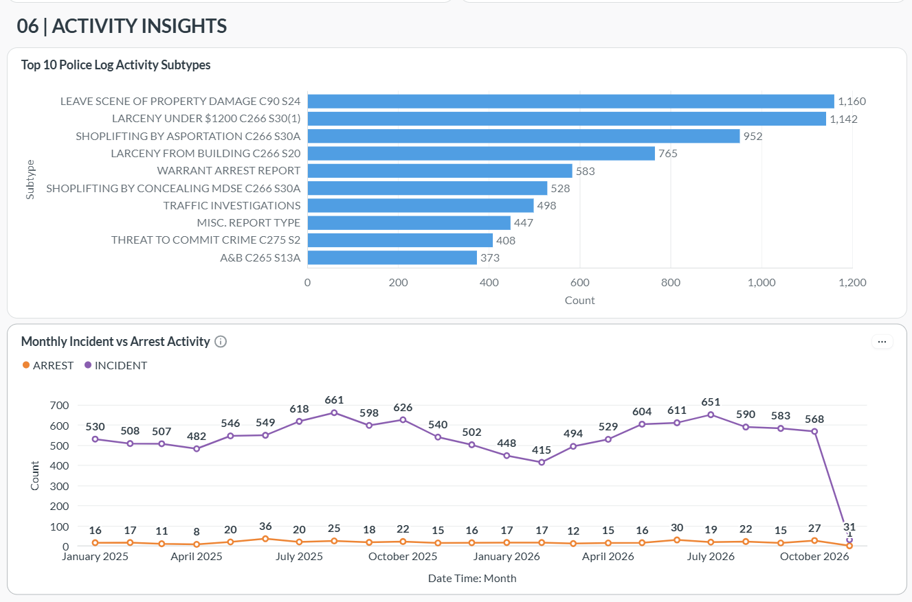
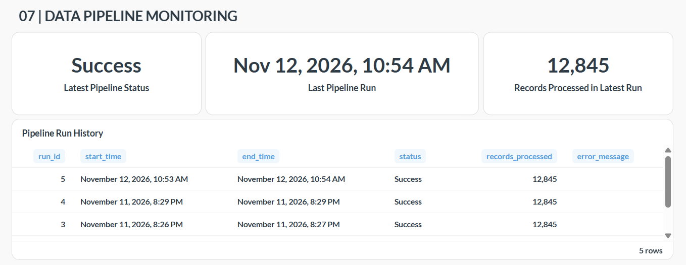

# Crime Trends Monitoring Data Pipeline

An end-to-end Data Engineering project that extracts, validates, transforms, and loads police activity records into PostgreSQL, enabling crime trend analysis and pipeline monitoring through an interactive Metabase dashboard.

## 1. Project Overview

The **Crime Trends Monitoring Data Pipeline** is designed to process police incident records from the Cambridge Police Department Daily Police Log dataset.

The project demonstrates an automated data engineering workflow involving:

- Data extraction from an online API.
- Data validation and cleaning.
- Data transformation and feature engineering.
- Loading structured records into PostgreSQL.
- Workflow orchestration using Prefect.
- Data visualization and monitoring using Metabase.
- Offline data processing through a local CSV backup.

The objective is to make police activity data easier to analyze by identifying temporal patterns, frequently recorded activity types, and locations.

## 2. Technologies Used

| Technology | Purpose |
|---|---|
| Python | Pipeline development |
| Pandas | Data manipulation and transformation |
| Requests | API data extraction |
| PostgreSQL | Relational database |
| SQLAlchemy | Database connectivity |
| Docker | Containerized services |
| Prefect | Workflow orchestration and scheduling |
| Metabase | Data visualization and dashboards |

## 3. Dataset

**Source:** Cambridge Police Department Daily Police Log

**Dataset:** [Cambridge Open Data Portal](https://data.cambridgema.gov/)

The project uses police activity records obtained through the Socrata Open Data API.

A local CSV copy is maintained to support offline execution and reproducibility.

## 4. System Architecture

```text
Cambridge Police API
        |
        v
   Data Extraction
        |
        v
 Data Validation
   and Cleaning
        |
        v
 Data Transformation
        |
        v
   Data Loading
        |
        v
    PostgreSQL
        |
        v
 Metabase Dashboard
```

**Workflow orchestration:** Prefect manages pipeline tasks, retries, execution monitoring, and scheduled runs.

**Offline support:** If API extraction fails, the pipeline can use the previously downloaded local CSV dataset.

## 5. Data Pipeline Workflow

### Stage 1: Data Extraction

- Retrieves police records from the Socrata API in batches.
- Supports API-based and local CSV extraction.
- Uses a local backup when API extraction fails.

### Stage 2: Data Validation and Cleaning

- Checks required columns.
- Identifies duplicate records.
- Validates date and timestamp fields.
- Handles missing values.

### Stage 3: Data Transformation

Creates additional analytical columns, including:

- Year
- Month
- Month Name
- Day
- Day Name
- Hour
- Time Period
- Year-Month
- Weekend Indicator

### Stage 4: Data Loading

- Loads transformed records into PostgreSQL.
- Uses SQLAlchemy for database connectivity.
- Maintains pipeline execution history.

## 6. Pipeline Orchestration and Monitoring

Prefect is used to orchestrate the pipeline.

The workflow consists of four main tasks:

1. Extract
2. Validate and Clean
3. Transform
4. Load

Features include:

- Task retries.
- Retry delays.
- Execution status tracking.
- Pipeline run history.
- Records processed per run.
- Scheduled execution.

A separate `pipeline_runs` table stores pipeline execution details.

## 7. Dashboard Preview

The project includes an interactive Metabase dashboard that provides insights into police activity patterns, recorded locations, temporal trends, and data pipeline health.

### 7.1 Dashboard Overview

Displays key performance indicators and monthly police log activity trends.


### 7.2 Temporal and Location Intelligence

Visualizes police activity across different days, time intervals, and recorded locations.


### 7.3 Activity Category and Weekly Patterns

Compares police activity categories and highlights weekday versus weekend patterns.


### 7.4 Detailed Activity Insights

Highlights frequently recorded activity subtypes and monthly Incident versus Arrest trends.



### 7.5 Data Pipeline Monitoring

Displays the latest pipeline execution status, records processed, and historical pipeline runs.



## 8. Project Structure

```text
Crime_Trends_Pipeline/
│
├── data/
│   ├── raw/
│   └── processed/
│
├── docs/
│   └── images/
│       ├── dashboard_overview.png
│       ├── temporal_location.png
│       ├── activity_patterns.png
│       ├── activity_insights.png
│       └── pipeline_monitoring.png
│
├── src/
│   └── crime_pipeline/
│       ├── extract.py
│       ├── extract_full_data.py
│       ├── inspect_data.py
│       ├── validate_data.py
│       ├── transform_data.py
│       ├── load_data.py
│       ├── db.py
│       └── pipeline.py
│
├── sql/
│   └── create_tables.sql
│
├── docker-compose.yml
├── requirements.txt
├── .env.example
├── .gitignore
└── README.md
```

## 9. Installation and Setup

### Prerequisites

- Python 3.12
- Docker Desktop
- Git
- Internet connection for initial dependency installation and API extraction

### Step 1: Clone the Repository

```bash
git clone https://github.com/Rimsha-Katoch/Crime-Trends-Data-Pipeline.git
cd Crime-Trends-Data-Pipeline
```

### Step 2: Create a Virtual Environment

```bash
python -m venv .venv
```

Activate it on Windows:

```powershell
.venv\Scripts\activate
```

### Step 3: Install Dependencies

```bash
pip install -r requirements.txt
```

### Step 4: Configure Environment Variables

Create a `.env` file using `.env.example` as a template.

Configure the PostgreSQL connection details and data source.

Keep your actual credentials private. Never upload `.env` to GitHub.

### Step 5: Start Docker Services

```bash
docker compose up -d
```

This starts the services defined in the Docker Compose configuration.

### Step 6: Run the Pipeline

Set the Python source directory:

```powershell
$env:PYTHONPATH = "src"
```

Execute the pipeline:

```powershell
python -c "from crime_pipeline.pipeline import crime_data_pipeline; crime_data_pipeline()"
```

### Step 7: Access the Services

| Service | Local URL |
|---|---|
| Metabase | http://localhost:3000 |
| Prefect UI | http://127.0.0.1:4200 |

The Metabase dashboard and database connection must be configured before viewing the analytics.

## 10. Online and Offline Execution

The pipeline supports two data source modes:

### Online Mode

- Set `DATA_SOURCE=api` in `.env`.
- Retrieves records from the online API.
- Updates the local CSV backup after successful extraction.
- Uses the local backup if API extraction fails.

### Offline Mode

- Set `DATA_SOURCE=local` in `.env`.
- Reads the previously downloaded CSV file.
- Allows pipeline execution without internet access, provided Docker and the local services are running.

## 11. Deployment

The project currently supports local execution and offline demonstration.

Cloud deployment is a planned extension that requires hosting the pipeline, database, orchestration services, and dashboard with appropriate persistent storage and security configuration.

## 12. Future Enhancements

- Cloud deployment with persistent database storage.
- Automated data quality reporting.
- Additional crime trend analytics.
- Advanced anomaly detection.
- More detailed pipeline performance monitoring.

## 13. Author

**Rimsha Katoch**

M.Tech Artificial Intelligence

GitHub: [Rimsha-Katoch](https://github.com/Rimsha-Katoch)

---

*This project was developed as a Data Engineering project to demonstrate data ingestion, transformation, workflow orchestration, database management, and analytical visualization.*
