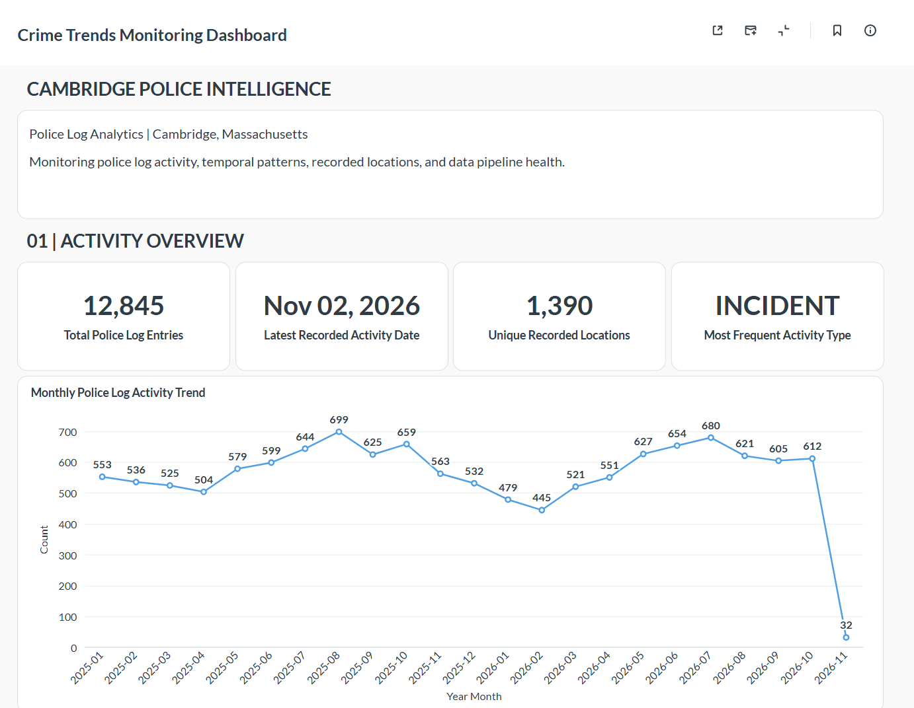
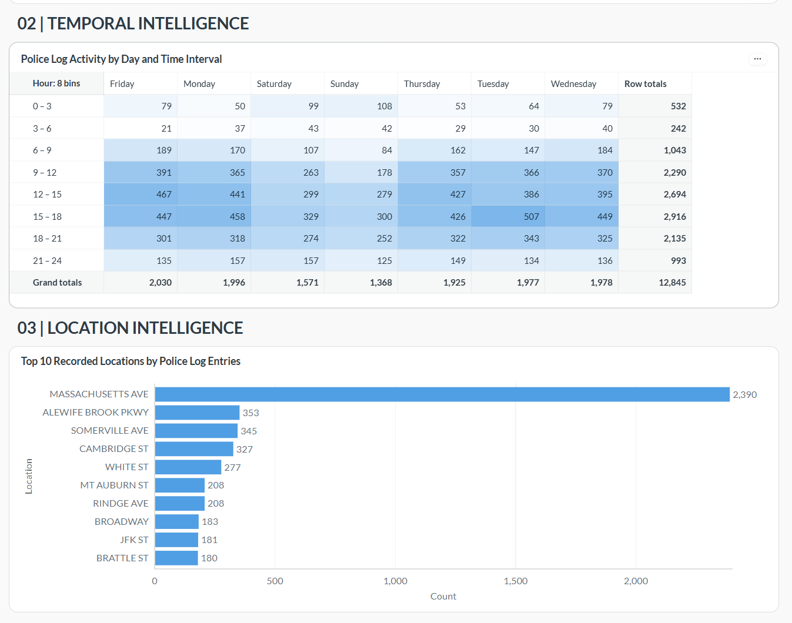
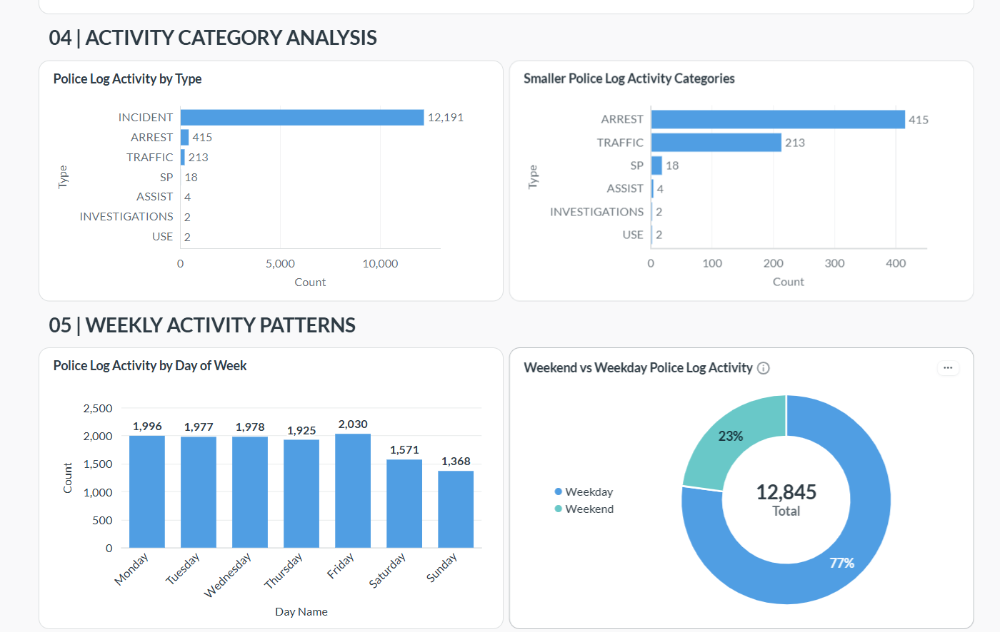

# Crime Trends Monitoring Data Pipeline

An end-to-end Data Engineering project that extracts, validates, transforms, and loads police activity records into PostgreSQL, enabling crime trend analysis and pipeline monitoring through an interactive Metabase dashboard.

## 1. Project Overview

The **Crime Trends Monitoring Data Pipeline** is designed to process police incident records from the Cambridge Police Department Daily Police Log dataset.

The project demonstrates an automated data engineering workflow involving:

- Data extraction from an online API.
- Data validation and cleaning.
- Data transformation and feature engineering.
- Loading structured records into PostgreSQL.
- Workflow orchestration using Prefect.
- Data visualization and monitoring using Metabase.
- Offline data processing through a local CSV backup.

The objective is to make police activity data easier to analyze by identifying temporal patterns, frequently recorded activity types, and recorded locations.

## 2. Technologies Used

| Technology | Purpose |
|---|---|
| Python | Pipeline development |
| Pandas | Data manipulation and transformation |
| Requests | API data extraction |
| PostgreSQL | Relational database |
| SQLAlchemy | Database connectivity |
| Docker | Containerized services |
| Prefect | Workflow orchestration and scheduling |
| Metabase | Data visualization and dashboards |
| Git and GitHub | Version control and project hosting |

## 3. Dataset

**Source:** Cambridge Police Department Daily Police Log

**Dataset:** [Cambridge Police Daily Police Log](https://data.cambridgema.gov/Public-Safety/Cambridge-Police-Daily-Police-Log/3gki-wyrb)

**Dataset ID:** `3gki-wyrb`

**API Endpoint:** `https://data.cambridgema.gov/resource/3gki-wyrb.json`

The project uses police activity records obtained through the Socrata Open Data API.

A local CSV copy is maintained to support offline execution and reproducibility.

## 4. System Architecture

The following diagram illustrates the overall data processing workflow.

```text
          Cambridge Police API
                   |
                   v
             Data Extraction
                   |
                   v
          Data Validation
             and Cleaning
                   |
                   v
          Data Transformation
                   |
                   v
              Data Loading
                   |
                   v
              PostgreSQL
                   |
                   v
           Metabase Dashboard
```

**Workflow orchestration:** Prefect manages pipeline tasks, retries, execution monitoring, and scheduled runs.

**Offline support:** If API extraction fails, the pipeline can use the previously downloaded local CSV dataset.

## 5. Data Pipeline Workflow

### Stage 1: Data Extraction

- Retrieves police records from the Socrata API in batches.
- Supports API-based and local CSV extraction.
- Uses a local backup when API extraction fails.
- Updates the local CSV backup after successful API extraction.

### Stage 2: Data Validation and Cleaning

- Checks required columns.
- Identifies duplicate records.
- Validates date and timestamp fields.
- Handles missing values.
- Ensures data consistency before transformation.

### Stage 3: Data Transformation

Creates additional analytical columns through feature engineering, including:

- Year
- Month
- Month Name
- Day
- Day Name
- Hour
- Time Period
- Year-Month
- Weekend Indicator

These features support temporal analysis and help identify patterns in police activity.

### Stage 4: Data Loading

- Loads transformed records into PostgreSQL.
- Uses SQLAlchemy for database connectivity.
- Maintains pipeline execution history.
- Stores structured records for dashboard analysis.

## 6. Pipeline Orchestration and Monitoring

Prefect is used to orchestrate and monitor the data pipeline.

The workflow consists of four main tasks:

1. Extract
2. Validate and Clean
3. Transform
4. Load

Features include:

- Task retries.
- Retry delays.
- Execution status tracking.
- Pipeline run history.
- Records processed per run.
- Scheduled execution.

A separate `pipeline_runs` table stores pipeline execution details, including run status, timestamps, and the number of records processed.

## 7. Dashboard Preview

The project includes an interactive Metabase dashboard that provides insights into police activity patterns, recorded locations, temporal trends, and data pipeline health.

### 7.1 Dashboard Overview

Displays key performance indicators and monthly police log activity trends.



### 7.2 Temporal and Location Intelligence

Visualizes police activity across different days, time intervals, and recorded locations.



### 7.3 Activity Category and Weekly Patterns

Compares police activity categories and highlights weekday versus weekend activity patterns.



### 7.4 Detailed Activity Insights

Highlights frequently recorded activity subtypes and monthly Incident versus Arrest trends.


### 7.5 Data Pipeline Monitoring

Displays the latest pipeline execution status, records processed, and historical pipeline runs.


## 8. Project Structure

```text
Crime_Trends_Pipeline/
│
├── data/
│   ├── raw/
│   │   ├── cambridge_police_log_full.csv
│   │   └── cambridge_police_log_sample.csv
│   │
│   └── processed/
│
├── docs/
│   └── images/
│       ├── dashboard_overview.png
│       ├── temporal_location.png
│       ├── activity_patterns.png
│       ├── activity_insights.png
│       └── pipeline_monitoring.png
│
├── src/
│   └── crime_pipeline/
│       ├── extract.py
│       ├── extract_full_data.py
│       ├── inspect_data.py
│       ├── validate_data.py
│       ├── transform_data.py
│       ├── load_data.py
│       ├── db.py
│       └── pipeline.py
│
├── sql/
│   └── create_tables.sql
│
├── tests/
│
├── logs/
│
├── docker-compose.yml
├── requirements.txt
├── .env.example
├── .gitignore
└── README.md
```

## 9. Installation and Setup

Follow these steps to set up and run the project on a local computer.

### Prerequisites

- Python 3.12
- Docker Desktop
- Git
- Internet connection for initial dependency installation and API extraction

### Step 1: Clone the Repository

```bash
git clone https://github.com/Rimsha-Katoch/Crime-Trends-Data-Pipeline.git

cd Crime-Trends-Data-Pipeline
```

### Step 2: Create a Virtual Environment

```bash
python -m venv .venv
```

Activate it on Windows:

```powershell
.venv\Scripts\activate
```

### Step 3: Install Dependencies

```bash
pip install -r requirements.txt
```

### Step 4: Configure Environment Variables

Create a `.env` file using `.env.example` as a template.

Configure the PostgreSQL connection details and data source.

Example configuration:

```env
POSTGRES_HOST=localhost
POSTGRES_PORT=5433
POSTGRES_DB=crime_db
POSTGRES_USER=crime_user
POSTGRES_PASSWORD=your_password

DATA_SOURCE=local
SOCRATA_DATASET_ID=3gki-wyrb
```

Replace the example password with your own password.

Keep your actual credentials private. Never upload `.env` to GitHub.

### Step 5: Start PostgreSQL Using Docker

Make sure Docker Desktop is running.

Execute:

```bash
docker compose up -d
```

This starts the PostgreSQL service defined in the Docker Compose configuration.

Verify that the container is running:

```bash
docker ps
```

### Step 6: Start the Prefect Server

Open a separate terminal, activate the virtual environment, and start the Prefect server:

```powershell
prefect server start
```

Keep this terminal running.

Configure Prefect to connect to the local server:

```powershell
prefect config set PREFECT_API_URL=http://127.0.0.1:4200/api
```

The Prefect UI will be available at:

http://127.0.0.1:4200

### Step 7: Run the Data Pipeline

Open another terminal in the project directory.

Activate the virtual environment:

```powershell
.venv\Scripts\activate
```

Set the Python source directory:

```powershell
$env:PYTHONPATH = "src"
```

Execute the pipeline once:

```powershell
python -c "from crime_pipeline.pipeline import crime_data_pipeline; crime_data_pipeline()"
```

This executes the extraction, validation, transformation, and loading tasks.

#### Scheduled Execution (Optional)

To start the Prefect deployment runner and enable scheduled execution, run:

```powershell
python .\src\crime_pipeline\pipeline.py
```

Keep this process running along with the Prefect server. The computer must remain awake, and the Docker services must remain available for scheduled runs.

The scheduled deployment is configured to run daily at 8:00 AM Asia/Kolkata time.

### Step 8: Start Metabase

Metabase is currently managed separately from Docker Compose.

**For the existing local installation:**

Start the existing container:

```powershell
docker start crime_metabase
```

**For a fresh installation on another computer:**

Create a Metabase container with persistent application storage:

```powershell
docker run -d --name crime_metabase -p 3000:3000 -v metabase_data:/metabase.db --restart unless-stopped metabase/metabase:latest
```

Open Metabase:

http://localhost:3000

A fresh Metabase installation will require initial setup and database configuration. It will not automatically contain the existing project dashboard.

### Step 9: Configure the PostgreSQL Connection in Metabase

In Metabase, add a new PostgreSQL database connection using the following settings:

| Setting | Value |
|---|---|
| Database type | PostgreSQL |
| Host | `host.docker.internal` |
| Port | `5433` |
| Database name | `crime_db` |
| Username | Your `POSTGRES_USER` |
| Password | Your `POSTGRES_PASSWORD` |

The Metabase container connects to PostgreSQL through the Docker host.

Save the connection and verify that the `crime_records` table is available.

The existing dashboard can be recreated or restored separately after the database connection is configured.

### Step 10: Access the Services

| Service | Local URL |
|---|---|
| Metabase | http://localhost:3000 |
| Prefect UI | http://127.0.0.1:4200 |

## 10. Online and Offline Execution

The pipeline supports two data source modes.

### Online Mode

Set the following variable in `.env`:

```env
DATA_SOURCE=api
```

In this mode:

- Retrieves records from the online Socrata API.
- Extracts data in batches.
- Updates the local CSV backup after successful extraction.
- Uses the local backup if API extraction fails and a valid backup is available.

An internet connection is required for API extraction.

### Offline Mode

Set the following variable in `.env`:

```env
DATA_SOURCE=local
```

In this mode:

- Reads the previously downloaded local CSV dataset.
- Processes records without accessing the online API.
- Supports offline pipeline execution, provided Docker, PostgreSQL, and the required local files are available.

## 11. Deployment

The project currently supports local execution and offline demonstration.

Cloud deployment is a planned extension that would require hosting the pipeline, database, orchestration services, and dashboard with appropriate persistent storage and security configuration.

## 12. Future Enhancements

Potential future improvements include:

- Cloud deployment with persistent database storage.
- Automated data quality reporting.
- Additional crime trend analytics.
- Advanced anomaly detection.
- More detailed pipeline performance monitoring.
- Improved dashboard accessibility and deployment.

## 13. Author

**Rimsha Katoch**

M.Tech in Artificial Intelligence (Pursuing)

GitHub: [Rimsha-Katoch](https://github.com/Rimsha-Katoch)

---

*This project was developed as a Data Engineering project to demonstrate data ingestion, data transformation, workflow orchestration, database management, and analytical visualization.*
